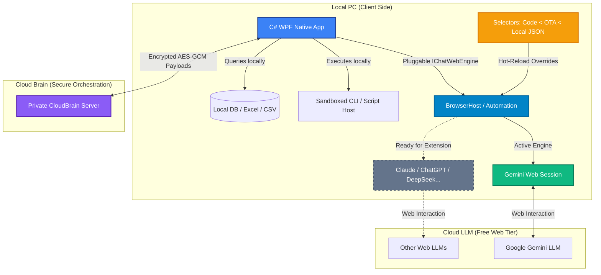

# 🤖 DWN.BRIDGE

<!-- VERSION_BADGE --> *Sync based on Private Release: **v1.0.0.65***

> "Faceless. Nameless. I just build the simulation. 'I can only show you the door. You're the one that has to walk through it.'" 💊

---

**DWN.BRIDGE** is an open-source, developer-first native Windows client that turns your free web-based LLMs into fully autonomous local agents with **zero API costs** and **100% raw data privacy**.

Featuring a pluggable **Multi-WebChat Engine architecture**, DWN.BRIDGE ships with full support for **Google Gemini** out-of-the-box and provides an extensible foundation designed to support multiple web-based chat interfaces (such as Claude, ChatGPT, and DeepSeek) with zero re-compilation needed for DOM selector updates.

Instead of paying for expensive cloud API tokens that burn through your budget, **DWN.BRIDGE** leverages a native WebView2/Playwright bridge to safely automate your browser session. It exposes a sandboxed local environment to the AI, allowing it to read/write files, write code, and query local databases while keeping your sensitive raw data on your own machine.

### 🌐 [ClickOnce Installer](https://www.dwnbridge.org/) | 🌐 [GitHub Mirror](https://marckdwn.github.io/DWN.BRIDGE/) | 📄 [Security Logs / Blog](https://www.dwnbridge.org/blog/) | 📺 [Demo Channel](https://www.youtube.com/@MarckDwn) | 💬 [Join Discord](https://discord.gg/45W4KDue8a)

[](https://www.youtube.com/watch?v=dCtOsXAuPgc)

---

## ✨ Features

- **🔌 Pluggable Multi-WebChat Architecture**: Completely decoupled browser automation engine (`IChatWebEngine`, `BrowserHost`, `EngineRegistry`). New engine providers can be implemented in complete isolation without altering core orchestration.
- **⚡ 3-Tier Selector Resolution & Zero-Recompile Hot-Reload**: Resilient to web UI changes. Selectors are resolved via a 3-tier cascade (`Code Defaults` < `OTA Server Config` < `Local JSON Override` in `%LocalAppData%\AIBridge\selectors\{engineId}.json`). Fix broken DOM selectors instantly with hot-reload—no app rebuild or restart needed!
- **🩺 DOM Diagnostics & Self-Healing (`SelfTestAsync`)**: Integrated diagnostics validate critical DOM selectors (TextArea, SendButton, etc.) against the live session, pinpointing UI breakage immediately.
- **🔑 Native Login Flow & Session Recovery**: Dedicated WebView2 authentication flows with automated cookie handoff to Playwright and active chat session recovery.
- **📉 Optimized Operational Costs**: Leverage the native capabilities of public web chat interfaces to orchestrate agentic workflows, drastically reducing typical API dependency and operational overhead.
- **🔒 Zero-Knowledge Privacy**: When querying databases (SQL Server, PostgreSQL, Excel, CSV), the client parses metadata/schemas locally and sends *only the schema* to the LLM. The LLM generates the query, and the client executes it locally. Your raw data never leaves your hard drive.
- **🛠️ Local Tool Integration**: Exposes filesystem operations (`READ_FILE`, `WRITE_FILE`), system commands (`RUN_COMMAND`), and SQL execution directly to the web chat session.
- **🤖 Custom Markdown Agents**: Author custom agents using simple Markdown profiles. Just describe their personality, list their tools, and publish them to your local directory.
- **⚡ High-Performance Native UI**: Written in C# WPF, optimized for low resource usage compared to bloated Electron-based alternatives.
- **🌍 Multilingual support**: Complete interface localized in 9 languages (EN, IT, ES, FR, DE, ZH, RU, JA, KO, PT).

---

## 📐 How it Works (Architecture)



1. **Pluggable Engine Bridge**: The client uses a stealth browser-automation layer (`BrowserHost`) that communicates with web chat interfaces through modular engine implementations (`IChatWebEngine`).
2. **Dynamic Selector Resolution**: If a provider updates their web layout, selectors can be overridden on-the-fly via local JSON files or server OTA updates without touching the binary.
3. **Encrypted Communication**: The client communicates with the private CloudBrain orchestrator via AES-GCM encrypted payloads to sync prompts and context safely.
4. **Local Action Execution**: When the LLM requests a tool call (e.g. running a script or fetching directory contents), the client intercepts the request, runs it locally within strict security boundaries, and feeds the output back into the chat.

---

## 🧩 Adding a New WebChat Engine

DWN.BRIDGE is built to be provider-agnostic. While Google Gemini is the active default engine, the architecture is ready for ChatGPT, Claude, DeepSeek, and other web chats.

Want to contribute a new engine or customize selectors?
👉 **Read the developer guide: [Docs/HowTo_Add_WebChat_Engine.md](Docs/HowTo_Add_WebChat_Engine.md)**

The guide covers:
- Implementing `IChatWebEngine` and registering it in `EngineRegistry`.
- Configuring the 3-tier selector hierarchy (`Defaults` < `OTA` < `Local JSON`).
- Writing DOM diagnostics with `SelfTestAsync`.
- Verifying your engine with the automated test suite (`ChatWebEngineContractTests`).

---

## 🛠️ How to Build (Developer Mode)

If you prefer to compile the client from source rather than using the pre-compiled installer:

### Prerequisites
- **.NET 10.0 SDK** (verified via `global.json`). If you do not have it, the build script will offer to install it automatically using `winget`.

### Steps

1. **Clone this repository:**
   ```bash
   git clone https://github.com/MarckDWN/DWN.BRIDGE.git
   cd DWN.BRIDGE
   ```

2. **Compile the project:**
   Run the automated build script in PowerShell. It will verify your SDK version, prompt to install .NET 10 if missing, and restore/build the solution:
   ```powershell
   .\build.ps1
   ```
   *(Alternatively, you can open `AIBridge.sln` in Visual Studio 2022 / Rider and build from the IDE, provided you have .NET 10 SDK installed).*

3. **Launch the Application:**
   Navigate to the output folder and run `DWN.Bridge.exe`:
   ```powershell
   cd bin\Debug\net10.0-windows
   .\DWN.Bridge.exe
   ```
   *(Note: On the first launch, the application will automatically download the Chromium binaries in background, showing a loading indicator. No manual installation is needed!).*

---

## 🤝 Community Agents
We welcome and encourage custom agent profiles! You can map dynamic tools and create personalized assistants. 
Simply define your agent in a `.md` file, place it in the custom agent directory:
`%AppData%\Local\AIBridge\customagents\<your-user-email>\`
and refresh the UI to test it!

---

## 🤝 Contributing
We are looking for co-maintainers and contributors to help build new database drivers, implement new WebChat engines, refine the C# WPF UI, and optimize local sandboxing. Please read our [CONTRIBUTING.md](CONTRIBUTING.md) guide and [Docs/HowTo_Add_WebChat_Engine.md](Docs/HowTo_Add_WebChat_Engine.md) to get started!

---

## ⚖️ License
This project is licensed under the MIT License. See the LICENSE file for details.
